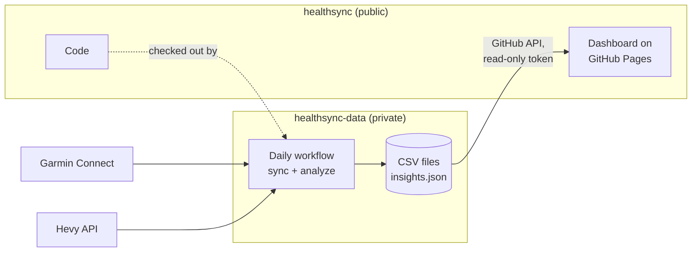

# healthsync

Personal training and recovery data in one place. healthsync pulls daily health metrics and
activities from Garmin Connect and workout sets from Hevy, stores them as plain CSV files, looks
for time-lagged relationships between them and shows everything on a static dashboard. It runs
locally or once a day on GitHub Actions.

> [!IMPORTANT]
> This repository holds **code only** and can be public. Your data lives in a second, **private**
> repository that is cloned into `data/`. `data/` is git-ignored here, so health data cannot be
> committed to this repository by accident.

## What you get

| Output | Content |
|---|---|
| `garmin_daily.csv` | One row per day: weight and body composition, sleep score and sleep times, HRV, resting heart rate, Body Battery, stress, steps, calories burned, Training Readiness |
| `garmin_activities.csv` | One row per watch activity: bouldering, hiking, cycling, runs, strength and more, with duration, distance, elevation gain, heart rate and training load |
| `hevy_sets.csv` | One row per set: workout, exercise, weight, reps, RPE, set type |
| `nutrition_daily.csv` | Optional, from YAZIO: one row per logged day with calories, protein, carbohydrates, fat and water |
| `insights.json` | Relationships between training, sleep and recovery that survive a statistical check, e.g. "1 hour later to bed: -2.0 ms HRV that night" |
| Dashboard | Charts and tables for all of the above, locally or on GitHub Pages, no build step |

## How it works



| Repository | Visibility | Content |
|---|---|---|
| `healthsync` (this one) | public | Python code, dashboard, documentation, tests; the dashboard is published with GitHub Pages |
| `healthsync-data` | **private** | The data files and the daily workflow with the Garmin and Hevy secrets. Workflow logs and caches stay private with it |

The dashboard on GitHub Pages contains no data. In the browser you connect it once with a
fine-grained token that can only read the data repository; it then loads the CSV files straight
from the GitHub API.

The sync is incremental: Garmin days that are complete are not fetched again (except the last
four, because the watch can sync late), and activities and Hevy sets inside the requested window
are replaced, so edited or deleted entries are picked up.

## Quick start

Requirements: Python 3.10 or newer, a Garmin Connect account, and Hevy Pro for the API key.

```bash
git clone https://github.com/sh4rkfx/healthsync.git && cd healthsync
git clone https://github.com/sh4rkfx/healthsync-data.git data   # your private data repository, see below
python3 -m venv .venv && source .venv/bin/activate              # Windows: .venv\Scripts\activate
pip install -r requirements.txt

python -m healthsync login                                      # Garmin email, password, MFA code
export HEVY_API_KEY="..."                                       # Windows PowerShell: $env:HEVY_API_KEY="..."
python -m healthsync sync --days 365                            # first run takes about 10 to 15 minutes
python -m healthsync analyze                                    # writes data/insights.json

python -m http.server 8000                                      # then open http://localhost:8000/dashboard/
```

Without a data repository, `data/` is just a local folder; everything works the same.

The Hevy API key is created at [hevy.com/settings?developer](https://hevy.com/settings?developer).
The Garmin password is only used for the first login; afterwards healthsync works with the tokens
stored in `~/.garminconnect`.

## Daily sync on GitHub

The workflow runs in the private data repository. It checks out this repository's code, fetches
the last 30 days every morning, recomputes the analysis and commits changed files.

1. Create an empty **private** repository, for example `healthsync-data`.
2. Copy the contents of [`templates/data-repo/`](templates/data-repo) into it, including the
   `.github` folder, together with any CSV files you already have, and push.
3. Locally, run `python -m healthsync export-tokens` and copy the single line of JSON it prints.
4. In the data repository under *Settings → Secrets and variables → Actions*, add two repository secrets:

   | Secret | Value |
   |---|---|
   | `GARMIN_TOKENS_JSON` | The JSON from step 3 |
   | `HEVY_API_KEY` | Your Hevy API key |

   With the GitHub CLI: `python -m healthsync export-tokens | gh secret set GARMIN_TOKENS_JSON --repo <you>/healthsync-data`.
5. Start the first run manually: *Actions → Sync Garmin and Hevy → Run workflow*. Use 365 days if
   the repository has no data yet.

The workflow uses `sh4rkfx/healthsync` for the code. For a fork, set the repository variable
`HEALTHSYNC_CODE_REPO` in the data repository to `<you>/healthsync`.

### Food intake from YAZIO (optional)

YAZIO has no public API. `healthsync` uses the private API of the YAZIO app, with the app's own
client credentials, to read the five daily totals (calories, protein, carbohydrates, fat, water).
It is unofficial, can break or be blocked without notice, and YAZIO's terms may not allow it.
Without the steps below, YAZIO is skipped.

1. Locally, run `python -m healthsync yazio-login`. The password is typed hidden and never stored,
   only the tokens are saved to `~/.yazio`.
2. Check the mapping against your real data: `python -m healthsync dump-yazio --date 2026-10-28`
   writes the raw responses to `debug/`, then `python -m healthsync sync --source yazio --days 14`.
3. Add the secret `YAZIO_TOKENS_JSON` to the data repository, with the output of
   `python -m healthsync yazio-tokens`. With the GitHub CLI:
   `python -m healthsync yazio-tokens | gh secret set YAZIO_TOKENS_JSON --repo <you>/healthsync-data`.

Without a local setup, GitHub can do the login: add the secrets `YAZIO_EMAIL` and `YAZIO_PASSWORD`
to the data repository and start the workflow once. It logs in, and the tokens stay in the Actions
cache. Then **delete `YAZIO_PASSWORD`** again. If you keep it, the workflow logs in again by itself
when the tokens stop working, at the price of a stored password. To check the mapping, start the
workflow with `yazio_dump_date` set: the raw responses of that day are attached to the run as a
private artifact for one day.

Like the Garmin tokens, the latest YAZIO tokens are carried from run to run in the Actions cache.
If a run fails with `YAZIO refused the login`, repeat steps 1 and 3. Days without any entry produce
no row, and a day that is only partly logged looks like a low-intake day.

Garmin may hand out a new refresh token whenever it refreshes a session, which would make the
secret outdated after the first run. The workflow therefore carries the latest tokens from run to
run in the Actions cache and only falls back to the secret when that cache is empty or no longer
valid. If a run fails with `No usable Garmin tokens`, log in locally again, export the tokens and
replace the secret.

## Dashboard

### Locally

```bash
git -C data pull                # latest data from the workflow
python -m http.server 8000      # in the repository root
```

Open <http://localhost:8000/dashboard/>. Opened directly as a file, the page cannot read the CSV
files and shows generated sample data instead, marked with a yellow notice.

### On GitHub Pages

1. In this repository under *Settings → Pages*, set *Source* to **Deploy from a branch**, branch
   `main`, folder `/ (root)`, and save. After a minute the dashboard is at
   `https://<you>.github.io/healthsync/`.
2. Create a fine-grained personal access token under *Settings → Developer settings → Personal
   access tokens → Fine-grained tokens*: *Repository access* only the data repository,
   *Permissions → Contents: Read-only*, nothing else.
3. Open the dashboard, choose **Mit GitHub verbinden**, enter the data repository and the token.

The token is kept in the browser: in `localStorage` with *Auf diesem Gerät merken*, otherwise only
until the tab is closed. It is sent to `api.github.com` and nowhere else. All GitHub Pages sites of
one account share the origin `<you>.github.io`, so scripts on your other Pages sites could read it;
keep that in mind if you publish other sites with third-party scripts. *Daten → Datenquellen*
shows the connection and disconnects it.

### Install as an app

The dashboard is a Progressive Web App. On GitHub Pages (or `localhost`) it can be installed:

| Device | How |
|---|---|
| iPhone, iPad | Safari → Share → *Add to Home Screen*. The installed app has its own storage, so connect it to GitHub once more after installing |
| Android | Chrome → menu → *Install app*, or the install button in the dashboard's top bar |
| Mac, PC | Chrome or Edge: install icon in the address bar or the dashboard's install button; Safari on the Mac: *File → Add to Dock* |

The service worker in `dashboard/sw.js` loads the app files from the network first and keeps a
copy for offline starts; data requests pass through it untouched. When the token is remembered,
the page keeps the files of the last GitHub load in the browser's Cache Storage and shows them,
marked as offline, when GitHub cannot be reached. Disconnecting deletes that copy. After a change
to the app files, raise `VERSION` in `sw.js` so old caches are removed.

### Keeping the data current

| Step | When |
|---|---|
| The workflow in the data repository fetches the last 30 days and commits | Every morning at 06:30 UTC (08:30 in summer, 07:30 in winter in Central Europe), or on demand with *Run workflow* |
| The dashboard on GitHub Pages reads the latest commit through the API | On every start, with the refresh button (key `R`), and automatically when the app comes back to the foreground after more than 15 minutes |
| A local checkout | `git -C data pull` |

The status line shows when the page loaded its data and warns when the newest Garmin day is two or
more days old.

### Areas

A bar at the top links to every area and holds the time range. Each area opens with one sentence
that sums it up, and can be collapsed; the sentence stays visible. The **?** on a card explains what
it shows and which columns it reads.

| Area | Content |
|---|---|
| Overview | Eight tiles for the last 7 days: weight, HRV, resting heart rate, Training Readiness, sleep, hard sets, active time, steps; two more with YAZIO data: calories and protein. Each tile links to its area |
| Körper | Weight with 7-day mean, change in fat and muscle mass |
| Erholung | HRV with Garmin's personal range, resting heart rate against its 60-day mean, sleep score, readiness and Body Battery |
| Schlaf | Bed and wake times per night, weekday against weekend nights, bedtime against HRV |
| Kraft | Estimated 1RM per main lift, weekly hard sets, Hevy workouts linked to the watch's strength recordings and compared by recovery the following night |
| Aktivitäten | Weekly active time per sport, steps against the 8,000 target, totals per sport, recent activities |
| Ernährung | Optional, from YAZIO: calories per day against Garmin's energy burned, weekly energy by macronutrient, protein per kg body weight against 1.6 and 2.2 g/kg, energy balance against the measured weight change, calories against HRV of the following night. Days under 1,200 kcal count as not fully logged and stay out of all means |
| Zusammenhänge | The results of `healthsync analyze`, filterable to robust findings, plus scatter plots for training load, tonnage and sleep against recovery and performance |
| Daten | Data source and connection, status of every data file with a fix when one is missing, empty or stale; weekly overview; all daily values; how each number is calculated |

The page warns when the newest Garmin day is two or more days old, which usually means the daily
workflow has stopped. Keyboard shortcuts: `1` to `8` jump to the areas, `0` back to the overview,
`Z` switches the time range, `?` opens the help. Range, collapsed areas, main lifts and the
findings filter are remembered in the browser.

Settings at the top of the dashboard script:

| Setting | Purpose |
|---|---|
| `MAIN_LIFTS` | Default lifts shown as e1RM charts, by their exact Hevy names. Without matches, the four most frequent exercises are used. The easier way is **Kraft → Übungen wählen** on the dashboard: it lists every exercise in your Hevy data, applies the choice at once, remembers it in the browser and copies it in this format if you want it as the default everywhere |
| `SPORTS` | Groups Garmin activity types into sports. The first matching pattern wins; the order sets colors and stacking |
| `MAX_LINK_GAP_MIN` | Maximum gap between the start of a Hevy workout and a strength activity on the watch to count them as one session (default 180) |
| `MIN_COMPLETE_KCAL` | YAZIO days below this count as not fully logged and stay out of all means (default 1,200; keep it equal to the constant in `healthsync/analyze.py`) |
| `DATA_REPO` | Data repository suggested in the connect dialog |

## Analysis

`python -m healthsync analyze` tests about 80 predefined pairs over the last 180 days, for example
*training load on a day → HRV in the following night* or *bedtime → strength performance the next
day*. In short:

- Each metric is compared with its own trailing 28-day mean, so slow drifts do not look like a relationship.
- Spearman rank correlation, robust against single extreme days.
- Effects are stated in real units, such as "-1.8 ms HRV per 100 points of training load".
- A Benjamini-Hochberg correction across all pairs. A finding is **robust** if it survives it
  (q < 0.10) and a **tendency** if it is only nominally significant (p < 0.05). On pure noise,
  roughly one run in ten reports a robust finding, which is the chosen error level.
- Pairs that Garmin itself computes from each other, such as sleep score and Training Readiness, are not tested.

Results describe association in your own data, not causation. A fixed weekly training schedule
and periods of illness are the two most common sources of misleading results. See
[docs/analysis.md](docs/analysis.md) for the full method, the list of tested pairs and how to read them.

## Commands

| Command | Purpose |
|---|---|
| `sync [--days N] [--source all\|garmin\|activities\|hevy\|yazio] [--refresh]` | Fetch data and update the CSV files. `all` includes YAZIO only after `yazio-login`. `--refresh` fetches stored Garmin days again, e.g. to fill columns added in an update |
| `analyze [--days N] [--top N]` | Test relationships and write `data/insights.json`. Prints the strongest findings |
| `login` | Log in to Garmin with email and password and store tokens |
| `export-tokens` | Print the Garmin tokens as JSON for the GitHub secret |
| `dump-raw [--date YYYY-MM-DD]` | Save all raw Garmin responses of one day to `debug/`, to check the field mapping |
| `yazio-login` | Log in to YAZIO with email and password and store tokens |
| `yazio-tokens` | Print the YAZIO tokens as JSON for the GitHub secret |
| `dump-yazio [--date YYYY-MM-DD]` | Save the raw YAZIO responses of one day to `debug/` |
| `-v` before any command | Debug logging |

All commands are run as `python -m healthsync <command>`.

## Configuration

| Environment variable | Default | Purpose |
|---|---|---|
| `HEVY_API_KEY` | none | Hevy API key; prompted for when missing and running locally |
| `GARMIN_TOKENS_JSON` | none | Garmin tokens as JSON, used in CI when no token file exists |
| `GARMIN_TOKEN_DIR` | `~/.garminconnect` | Where Garmin tokens are stored |
| `GARMIN_EMAIL`, `GARMIN_PASSWORD` | none | Optional, skips the prompts of `login` |
| `YAZIO_TOKENS_JSON` | none | YAZIO tokens as JSON, used in CI when no token file exists |
| `YAZIO_TOKEN_DIR` | `~/.yazio` | Where YAZIO tokens are stored |
| `YAZIO_EMAIL`, `YAZIO_PASSWORD` | none | Optional, skips the prompts of `yazio-login` |
| `HEALTHSYNC_DATA_DIR` | `data` | Folder for the CSV and JSON files |
| `HEALTHSYNC_TZ` | `Europe/Vienna` | Time zone for local dates, sleep times and Hevy timestamps |

## Troubleshooting

| Symptom | Cause and fix |
|---|---|
| A column stays empty | Garmin's field names are undocumented. Run `dump-raw` for an affected day and compare `debug/garmin_raw_<date>.json` with the `parse_*` functions in `healthsync/garmin.py` |
| Dashboard shows sample data | Locally: the page was opened as a file, or the server was started outside the repository root. On GitHub Pages: not connected yet, or the token expired; the yellow notice says which |
| HTTP 429 from Garmin | Too many requests. Days fetched so far are saved; run again after an hour |
| Login works locally but fails on GitHub | Garmin sometimes blocks data-center addresses. Run the workflow on a self-hosted runner (`runs-on: self-hosted`) |
| Push from the workflow fails with 403 | The data repository's workflow token is read-only: *Settings → Actions → General → Workflow permissions → Read and write permissions* |
| Sleep times are missing for older days | They were added in an update. Run `sync --days 365 --refresh` once |

## Privacy and security

- Health data lives only in the private data repository and in your local `data/` folder. This
  repository ignores `data/` and `debug/`.
- The sync runs in the private repository, so its logs, the Actions cache with the Garmin tokens
  and the secrets never touch this public repository.
- The Garmin and YAZIO passwords are never stored, neither locally nor on GitHub. Only tokens are.
- The dashboard token can only read the data repository. Revoke it on GitHub if a device is lost.
- Anyone with write access to the data repository can change its workflow and read its secrets. Do not add collaborators.
- Raw dumps from `dump-raw` contain health data. They stay in `debug/`, which is not committed.

## Development

```
healthsync/
  __main__.py     command line interface
  config.py       paths, time zone, settings
  garmin.py       Garmin login, daily metrics, raw dumps
  activities.py   Garmin activities
  hevy.py         Hevy workouts and sets
  yazio.py        YAZIO daily food totals (unofficial app API)
  analyze.py      relationship analysis, insights.json
  csvstore.py     atomic CSV writes
dashboard/
  index.html      static dashboard, sample data built in
  manifest.webmanifest, sw.js, icons/   installable app
docs/
  analysis.md     analysis method and how to read results
  data-reference.md   every column and the insights.json format
  scores.md       evidence-based design of the daily scores (not yet implemented)
templates/
  data-repo/      README, .gitignore and daily workflow for the private data repository
tests/            pytest suite
index.html        forwards GitHub Pages visitors to dashboard/
```

```bash
pip install -r requirements-dev.txt
pytest          # parsers, time zones, CSV loading, analysis on synthetic data
ruff check .
```

The workflow in `.github/workflows/test.yml` runs both on every push.

## Disclaimer

healthsync uses the unofficial `garminconnect` library, which can break when Garmin changes its
private API. The optional YAZIO import uses YAZIO's private app API in the same way. The Hevy API is official but requires Hevy Pro. Nothing here is medical advice; the
numbers come from consumer devices and their estimates.
