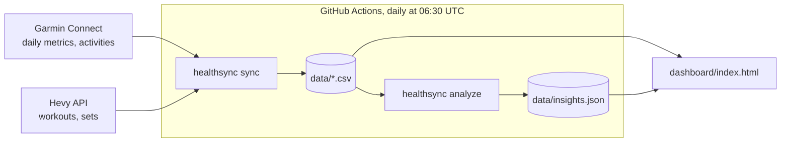

# healthsync

Personal training and recovery data in one place. healthsync pulls daily health metrics and
activities from Garmin Connect and workout sets from Hevy, stores them as plain CSV files in
this repository, looks for time-lagged relationships between them and shows everything on a
static dashboard. It runs locally or once a day on GitHub Actions.

> [!IMPORTANT]
> Keep this repository **private**. The data files contain health data, and anything that is
> committed stays in the Git history.

## What you get

| Output | Content |
|---|---|
| `data/garmin_daily.csv` | One row per day: weight and body composition, sleep score and sleep times, HRV, resting heart rate, Body Battery, stress, steps, calories burned, Training Readiness |
| `data/garmin_activities.csv` | One row per watch activity: bouldering, hiking, cycling, runs, strength and more, with duration, distance, elevation gain, heart rate and training load |
| `data/hevy_sets.csv` | One row per set: workout, exercise, weight, reps, RPE, set type |
| `data/insights.json` | Relationships between training, sleep and recovery that survive a statistical check, e.g. "1 hour later to bed: -2.0 ms HRV that night" |
| `dashboard/index.html` | Charts and tables for all of the above, no build step |

## How it works



The sync is incremental: Garmin days that are complete are not fetched again (except the last
four, because the watch can sync late), and activities and Hevy sets inside the requested window
are replaced, so edited or deleted entries are picked up.

## Quick start

Requirements: Python 3.10 or newer, a Garmin Connect account, and Hevy Pro for the API key.

```bash
git clone https://github.com/<you>/<repo>.git && cd <repo>
python3 -m venv .venv && source .venv/bin/activate     # Windows: .venv\Scripts\activate
pip install -r requirements.txt

python -m healthsync login                             # Garmin email, password, MFA code
export HEVY_API_KEY="..."                              # Windows PowerShell: $env:HEVY_API_KEY="..."
python -m healthsync sync --days 365                   # first run takes about 10 to 15 minutes
python -m healthsync analyze                           # writes data/insights.json

python -m http.server 8000                             # then open http://localhost:8000/dashboard/
```

The Hevy API key is created at [hevy.com/settings?developer](https://hevy.com/settings?developer).
The Garmin password is only used for the first login; afterwards healthsync works with the tokens
stored in `~/.garminconnect`.

## Daily sync on GitHub

The workflow in `.github/workflows/sync.yml` fetches the last 30 days every morning, recomputes
the analysis and commits changed files.

1. Push this folder to a **private** repository.
2. Locally, run `python -m healthsync export-tokens` and copy the single line of JSON it prints.
3. Under *Settings → Secrets and variables → Actions*, add two repository secrets:

   | Secret | Value |
   |---|---|
   | `GARMIN_TOKENS_JSON` | The JSON from step 2 |
   | `HEVY_API_KEY` | Your Hevy API key |

4. Under *Settings → Actions → General → Workflow permissions*, select **Read and write permissions**.
5. Start the first run manually: *Actions → Sync Garmin and Hevy → Run workflow*.

Garmin may hand out a new refresh token whenever it refreshes a session, which would make the
secret outdated after the first run. The workflow therefore carries the latest tokens from run to
run in the Actions cache and only falls back to the secret when that cache is empty or no longer
valid. If a run fails with `No usable Garmin tokens`, log in locally again, export the tokens and
replace the secret.

## Dashboard

```bash
python -m http.server 8000      # in the repository root
```

Open <http://localhost:8000/dashboard/>. Opened directly as a file, the page cannot read the CSV
files and shows generated sample data instead, marked with a yellow notice.

A bar at the top links to every area and holds the time range. Each area opens with one sentence
that sums it up, and can be collapsed; the sentence stays visible. The **?** on a card explains what
it shows and which columns it reads.

| Area | Content |
|---|---|
| Overview | Eight tiles for the last 7 days: weight, HRV, resting heart rate, Training Readiness, sleep, hard sets, active time, steps. Each tile links to its area |
| Körper | Weight with 7-day mean, change in fat and muscle mass |
| Erholung | HRV with Garmin's personal range, resting heart rate against its 60-day mean, sleep score, readiness and Body Battery |
| Schlaf | Bed and wake times per night, weekday against weekend nights, bedtime against HRV |
| Kraft | Estimated 1RM per main lift, weekly hard sets, Hevy workouts linked to the watch's strength recordings and compared by recovery the following night |
| Aktivitäten | Weekly active time per sport, steps against the 8,000 target, totals per sport, recent activities |
| Zusammenhänge | The results of `healthsync analyze`, filterable to robust findings, plus scatter plots for training load, tonnage and sleep against recovery and performance |
| Daten | Status of every data file with a fix when one is missing, empty or stale; weekly overview; all daily values; how each number is calculated |

The page warns when the newest Garmin day is two or more days old, which usually means the daily
workflow has stopped. Keyboard shortcuts: `1` to `7` jump to the areas, `0` back to the overview,
`Z` switches the time range, `?` opens the help. Range, collapsed areas and the findings filter are
remembered in the browser.

Three settings at the top of the dashboard script are meant to be edited:

| Setting | Purpose |
|---|---|
| `MAIN_LIFTS` | Default lifts shown as e1RM charts, by their exact Hevy names. Without matches, the four most frequent exercises are used. The easier way is **Kraft → Übungen wählen** on the dashboard: it lists every exercise in your Hevy data, applies the choice at once, remembers it in the browser and copies it in this format if you want it as the default everywhere |
| `SPORTS` | Groups Garmin activity types into sports. The first matching pattern wins; the order sets colors and stacking |
| `MAX_LINK_GAP_MIN` | Maximum gap between the start of a Hevy workout and a strength activity on the watch to count them as one session (default 180) |

## Analysis

`python -m healthsync analyze` tests about 80 predefined pairs over the last 180 days, for example
*training load on a day → HRV in the following night* or *bedtime → strength performance the next
day*. In short:

- Each metric is compared with its own trailing 28-day mean, so slow drifts do not look like a relationship.
- Spearman rank correlation, robust against single extreme days.
- Effects are stated in real units, such as "-1.8 ms HRV per 100 points of training load".
- A Benjamini-Hochberg correction across all pairs. A finding is **robust** if it survives it
  (q < 0.10) and a **tendency** if it is only nominally significant (p < 0.05). On pure noise,
  roughly one run in ten reports a robust finding, which is the chosen error level.
- Pairs that Garmin itself computes from each other, such as sleep score and Training Readiness, are not tested.

Results describe association in your own data, not causation. A fixed weekly training schedule
and periods of illness are the two most common sources of misleading results. See
[docs/analysis.md](docs/analysis.md) for the full method, the list of tested pairs and how to read them.

## Commands

| Command | Purpose |
|---|---|
| `sync [--days N] [--source all\|garmin\|activities\|hevy] [--refresh]` | Fetch data and update the CSV files. `--refresh` fetches stored Garmin days again, e.g. to fill columns added in an update |
| `analyze [--days N] [--top N]` | Test relationships and write `data/insights.json`. Prints the strongest findings |
| `login` | Log in to Garmin with email and password and store tokens |
| `export-tokens` | Print the Garmin tokens as JSON for the GitHub secret |
| `dump-raw [--date YYYY-MM-DD]` | Save all raw Garmin responses of one day to `debug/`, to check the field mapping |
| `-v` before any command | Debug logging |

All commands are run as `python -m healthsync <command>`.

## Configuration

| Environment variable | Default | Purpose |
|---|---|---|
| `HEVY_API_KEY` | none | Hevy API key; prompted for when missing and running locally |
| `GARMIN_TOKENS_JSON` | none | Garmin tokens as JSON, used in CI when no token file exists |
| `GARMIN_TOKEN_DIR` | `~/.garminconnect` | Where Garmin tokens are stored |
| `GARMIN_EMAIL`, `GARMIN_PASSWORD` | none | Optional, skips the prompts of `login` |
| `HEALTHSYNC_DATA_DIR` | `data` | Folder for the CSV and JSON files |
| `HEALTHSYNC_TZ` | `Europe/Vienna` | Time zone for local dates, sleep times and Hevy timestamps |

## Troubleshooting

| Symptom | Cause and fix |
|---|---|
| A column stays empty | Garmin's field names are undocumented. Run `dump-raw` for an affected day and compare `debug/garmin_raw_<date>.json` with the `parse_*` functions in `healthsync/garmin.py` |
| Dashboard shows sample data | The page was opened as a file, or the server was started outside the repository root |
| HTTP 429 from Garmin | Too many requests. Days fetched so far are saved; run again after an hour |
| Login works locally but fails on GitHub | Garmin sometimes blocks data-center addresses. Run the workflow on a self-hosted runner (`runs-on: self-hosted`) |
| Push from the workflow fails with 403 | Workflow permissions are read-only, see step 4 of the GitHub setup |
| Sleep times are missing for older days | They were added in an update. Run `sync --days 365 --refresh` once |

## Privacy and security

- Credentials live only in `~/.garminconnect`, environment variables and GitHub secrets. `.gitignore`
  keeps token folders and `debug/` out of the repository.
- The Garmin password is never stored, neither locally nor on GitHub.
- Anyone with write access to the repository can change the workflow and read its secrets. Do not add collaborators.
- Raw dumps from `dump-raw` contain health data. They stay in `debug/`, which is not committed.

## Development

```
healthsync/
  __main__.py     command line interface
  config.py       paths, time zone, settings
  garmin.py       Garmin login, daily metrics, raw dumps
  activities.py   Garmin activities
  hevy.py         Hevy workouts and sets
  analyze.py      relationship analysis, insights.json
  csvstore.py     atomic CSV writes
dashboard/
  index.html      static dashboard, sample data built in
docs/
  analysis.md     analysis method and how to read results
  data-reference.md   every column and the insights.json format
  scores.md       evidence-based design of the daily scores (not yet implemented)
tests/            pytest suite
```

```bash
pip install -r requirements-dev.txt
pytest          # parsers, time zones, CSV loading, analysis on synthetic data
ruff check .
```

## Disclaimer

healthsync uses the unofficial `garminconnect` library, which can break when Garmin changes its
private API. The Hevy API is official but requires Hevy Pro. Nothing here is medical advice; the
numbers come from consumer devices and their estimates.
